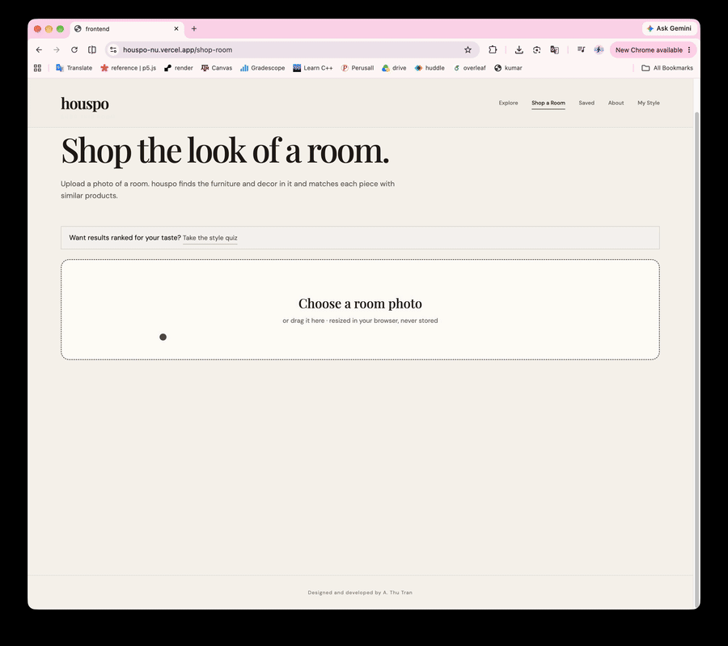

# houspo

**Personalized interior design discovery powered by live product data, computer vision, and AI.**

houspo helps users discover furniture, decor, and lighting that match their personal interior style. Users build a style profile through a preference quiz, and houspo combines recommendation logic, live product data, and AI-assisted ranking to curate products specifically for them.

With **Shop this room**, users can also upload a photo of a room. houspo finds each piece of furniture and decor in it and matches it with visually similar products from the live catalog, ranked for the user's style and budget.



<sub>Demo room photo from Unsplash.</sub>

## Live Demo

**[Visit houspo →](https://houspo-nu.vercel.app/)**

## Features

- **Shop this room:** upload a room photo, click any detected item, and see similar products
- Interactive interior style preference quiz
- Space, product category, color, material, and budget preferences
- Live furniture, decor, and lighting discovery
- Personalized product match scores and explanations
- AI-generated interior style profiles
- Hybrid recommendation ranking using houspo's matching algorithm and AI scoring
- Multi-category product discovery
- Search, category, price, and sorting filters
- Save products for later
- "Not my style" feedback to improve recommendation ordering
- Personalized "My Style" page based on saved products
- Product detail pages with similar product recommendations
- Responsive interface for desktop and mobile
- Graceful fallback when live product or AI services are unavailable

## How Recommendations Work

houspo uses a hybrid recommendation system rather than relying entirely on AI.

1. Live products are retrieved based on the user's space and selected product categories.
2. Product data is normalized and filtered before recommendation scoring.
3. houspo's rule-based recommendation system evaluates products against the user's styles, colors, materials, space, categories, budget, and feedback.
4. The strongest candidates are evaluated using an AI-generated style profile.
5. Final rankings combine **70% houspo recommendation logic** with **30% AI scoring**.

This approach keeps recommendations grounded in explicit user preferences while allowing AI to better evaluate overall aesthetic compatibility.

## How Shop This Room Works

1. **Upload:** the photo is resized in the browser, turned upright using the phone's orientation tag, and stripped of metadata such as location before it is sent.
2. **Detect:** YOLOE, an open-vocabulary detector, finds furniture and decor using 42 text prompts. Specific prompts like "dining chair" sit alongside generic ones like "chair" and "lamp", plus negative prompts like "television" and "window" that discard look-alikes.
3. **Embed:** each detected item is cropped and embedded with SigLIP 2. A small learned adapter maps room-photo crops closer to catalog-style product photos.
4. **Search:** exact cosine search over pre-computed embeddings of 779 live Channel3 products. Each item only searches its category group; a sofa, for example, searches sofas and sectionals.
5. **Rank for the user:** visual similarity (70%) is blended with houspo's existing preference score (30%). Products outside the user's budget are listed separately, and "Not my style" pushes products down.
6. **Explore:** each item is outlined on the photo and can be clicked to see its matches. A "Whole room" row shows matches for the photo as a whole.

If the vision service is slow, down, or rate-limited, the page falls back to regular recommendations for the user's space, following the same pattern as the AI fallback.

## Shop This Room Evaluation

Results are measured on two test sets.

**1. Catalog test set:** 544 room → product pairs mined from Channel3 lifestyle photos, across 26 categories, searching a 779-product catalog.
- In each pair, the in-room photo is the query and that product is the correct answer.
- Other retailers' listings of the same product (same brand and title) also count as correct.
- Pairs whose "room" photo is a near-duplicate of the product photo were removed.

| Approach | Top-1 | Top-5 | MRR |
|---|---|---|---|
| CLIP ViT-B/32, whole photo (baseline) | 41.9% | 69.3% | 0.537 |
| SigLIP 2, whole photo | 53.3% | 77.9% | 0.641 |
| SigLIP 2, detected item crop + category search | 63.1% | 85.1% | 0.730 |
| **+ learned adapter (5-fold cross-validated)** | **68.8%** | **88.8%** | **0.778** |

The adapter is evaluated with 5-fold cross-validation by product. Every test photo is scored by an adapter that never saw that product during training, and it improved Top-5 in all five folds.

**2. Real room photos:** 29 room photos, hand-labeled with a candidate pool drawn from several models and shuffled to avoid favoring any one model.
- 95.9% of detections were real furniture or decor.
- 131 detected items had at least one close match in the catalog. A further 21% of real items had no close match among the 779 products, which is a catalog limit rather than a model error.

| Approach (131 items) | Top-1 | Top-5 | MRR |
|---|---|---|---|
| CLIP ViT-B/32, detected item crop | 22.9% | 63.4% | 0.388 |
| SigLIP 2, detected item crop | 37.4% | 74.8% | 0.522 |
| **SigLIP 2 + adapter** | **37.4%** | **78.6%** | **0.527** |

**Latency**

| Setup | Time |
|---|---|
| Apple Silicon laptop | about 160 ms per photo |
| Deployed on Modal CPU, processing | about 1 s |
| Deployed on Modal CPU, warm round trip | about 2.4 s |
| Deployed on Modal CPU, cold start | about 27 s |

The cold-start case is hidden by warming the service when the Shop a Room page opens.

**What didn't help**
- Cutting items out with their segmentation mask scored 8.5 points lower in Top-5 than a plain box crop.
- A larger YOLOE model doubled detection time with no accuracy gain.

**Known limitations**
- Real rooms are much harder than catalog photos: about 37% Top-1, against about 69% on catalog photos.
- Ceiling fans and plant shelves are sometimes detected as lamps.
- With 131 real items, each real-photo number has a margin of about ±7 points.

Full results, scripts, and how to reproduce them are in [`vision/`](vision/README.md).

## Tech Stack

### Frontend

- React
- Vite
- JavaScript
- React Router
- CSS

### Backend

- Node.js
- Express
- REST APIs

### Computer Vision

- Python, PyTorch
- YOLOE (Ultralytics), open-vocabulary detection and segmentation
- SigLIP 2 (Hugging Face Transformers), image embeddings
- OpenCLIP (CLIP ViT-B/32 baseline)
- NumPy vector search with a learned query adapter
- FastAPI

### APIs & AI

- OpenAI API
- Channel3 API (text search for products)

### Deployment

- Vercel — frontend
- Render — backend
- Modal — vision service (CPU, scales to zero, spending-limited)

## Architecture

```text
User Preferences
      ↓
Live Product Discovery
      ↓
Product Normalization & Filtering
      ↓
houspo Recommendation Scoring
      ↓
Top Recommendation Candidates
      ↓
AI Style Profile & Product Scoring
      ↓
Hybrid Ranking
70% Rules + 30% AI
      ↓
Personalized Recommendations
```

### Shop This Room

```text
Room Photo (resized in browser)
      ↓
Express /api/vision/shop-room ──(unavailable)──→ Regular Recommendations
      ↓
FastAPI Vision Service (Modal)
      ↓
YOLOE Detection → Item Crops
      ↓
SigLIP 2 + Adapter Embeddings
      ↓
Category-Grouped Vector Search
      ↓
70% Visual Similarity + 30% Style Profile
      ↓
Clickable Items with Matching Products
```

## Reliability

houspo is designed so AI enhances the recommendation system rather than being required for it. If AI scoring is unavailable, the application falls back to houspo's rule-based recommendations. Live product requests also include fallback behavior so the core experience remains usable when an external service is temporarily unavailable.

The same applies to Shop this room:
- If the vision service is not configured, does not respond within 60 seconds, or hits its Modal spending limit, the page shows regular recommendations instead.
- The vision service only accepts requests carrying a shared key from the houspo backend.
- Channel3 calls made while building the catalog and running evaluations are cached and capped.
